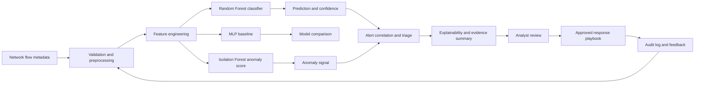

# Design Report: AI-Based Threat Detection and Prevention System

**Student:** Bhaumik Senwal  
**Roll Number:** 2301730328  
**Project Type:** AI / Cybersecurity Capstone Lab  
**Environment:** Synthetic mid-sized enterprise network

## 1. Executive summary

This project presents an academic prototype for identifying suspicious network-flow behaviour in a mid-sized enterprise environment. It models five attack families—distributed denial of service (DDoS), port scanning, brute-force authentication, suspected data exfiltration, and command-and-control (C2) beaconing—alongside normal traffic. A Random Forest is used as the primary multi-class classifier, a multilayer perceptron (MLP) provides a neural-network baseline, and an Isolation Forest provides an unsupervised anomaly score.

The pipeline includes engineered traffic features, a stratified train/test split, class-level evaluation, a simplified evasion experiment, adversarial data augmentation, model explanations, an analyst-oriented response playbook, pseudonymisation, and a false-positive comparison by time of day. All observations are synthetic and all performance results are written by the notebook to `outputs/results.json` after execution. They must not be interpreted as production performance claims.

## 2. Problem statement and objectives

Enterprise security teams receive large volumes of network events and need to prioritise suspicious behaviour without overwhelming analysts with false alarms. The project explores how machine-learning methods can support this triage task.

The objectives are to:

1. Generate a labelled synthetic network-flow dataset containing normal traffic and five threat categories.
2. Engineer features that represent traffic volume, connection behaviour, authentication failures, destination diversity, and beacon regularity.
3. Train and compare supervised and unsupervised detection models.
4. Evaluate performance with class-aware metrics and inspect common classification errors.
5. Simulate feature-level evasion and assess whether adversarial augmentation improves robustness.
6. Explain model behaviour in terms that can support analyst review.
7. Define a response workflow that requires human approval for disruptive actions.
8. Demonstrate privacy and fairness checks and identify their limitations.

## 3. Scope and assumptions

The prototype operates on aggregate flow metadata rather than packet payloads. Inputs represent duration, byte counts, packet counts, connection rates, destination-port diversity, failed logins, DNS entropy, beacon timing, off-hours activity, destination risk, and outbound volume.

The dataset is simulated from hand-designed distributions. A portion of attack records is blended with normal-like values to add overlap. This design allows a controlled experiment but does not capture the full diversity, noise, drift, topology, or adversarial adaptation found in live networks. The project is not a substitute for a production IDS, SIEM, EDR, or managed detection service.

## 4. Threat model

| Threat | Attacker objective | Observable flow behaviour | Initial severity |
|---|---|---|---|
| DDoS | Exhaust network or service capacity | High packet/SYN and connection rates | Critical |
| Port scan | Discover exposed services | Many ports contacted, short connections | Medium |
| Brute force | Guess credentials | Repeated failed logins and concentrated attempts | High |
| Data exfiltration | Remove sensitive data | Unusual outbound volume, byte imbalance, off-hours transfers | Critical |
| C2 beaconing | Maintain remote control of a compromised host | Repeated low-volume connections and regular timing | High |

The model is intended to identify behavioural indicators, not to attribute activity to a specific person or actor. A predicted label is a lead for investigation and should be correlated with endpoint, identity, DNS, firewall, and application telemetry.

## 5. Proposed system architecture

### Component responsibilities

- **Input and preprocessing:** validates numeric flow metadata and handles invalid values.
- **Feature engineering:** creates log-scaled byte counters, byte imbalance, packets per second, failed-login rate, beacon regularity, and an exfiltration signal.
- **Detection layer:** applies a supervised classifier for known classes and an anomaly model trained only on normal flows.
- **Evaluation and explanation:** reports class-level performance, confusion patterns, anomaly AUC, permutation importance, and local deviation context.
- **Triage and response:** assigns a severity recommendation and routes low-confidence cases to analyst review.
- **Audit and feedback:** stores decisions and investigation outcomes so a future model can be evaluated for drift and retrained under change control.

## 6. Data and feature methodology

The generator creates 12,000 records with an imbalanced distribution: 8,000 normal flows, 1,000 each for DDoS, port scanning, and brute force, 600 for data exfiltration, and 400 for C2 beaconing. The notebook fixes the random seed to 42. Twelve percent of attack rows are blended with normal-like values to introduce overlap.

The engineered feature set includes:

- Log-transformed sent and received bytes.
- Difference between sent and received log-bytes.
- Bytes per packet and packets per second.
- Log-transformed connection duration.
- SYN rate and unique destination ports.
- Failed logins and failed-logins-per-connection rate.
- Connections per minute.
- Beacon regularity derived from timing jitter.
- DNS entropy, outbound megabytes, off-hours indicator, and destination risk.
- A composite exfiltration signal based on outbound volume, off-hours activity, and byte imbalance.

The split is stratified with 75% for training and 25% for testing. A random split is suitable for a reproducible classroom demonstration, but a real deployment should use chronological and environment-based holdouts to reduce leakage from correlated flows.

## 7. Model design

### Random Forest

The primary classifier uses an ensemble of decision trees with class weighting. It supports non-linear feature interactions and exposes impurity-based importance. It is evaluated with accuracy, macro-F1, and per-class precision, recall, and F1.

### Multilayer perceptron

The MLP uses a standardisation pipeline and two hidden layers. It acts as a neural-network baseline. Its performance is compared with the Random Forest using the same test split.

### Isolation Forest

The Isolation Forest is fitted only on normal training records. Its anomaly score is compared between normal flows and each attack family using ROC-AUC. This model does not provide a threat-family label; it is a complementary signal for unusual behaviour.

## 8. Adversarial robustness experiment

The experiment moves a selected group of attacker-influenced features toward the normal-training median. The perturbation strength, epsilon, ranges from zero to 0.75. The baseline model's attack recall is measured at each level. A second Random Forest is trained with additional perturbed attack examples, and its recall is compared on the same transformed test flows.

The comparison also reports macro-F1 and false-positive rate on clean test data. These checks are important because robustness improvements under one attack simulation may reduce normal-traffic performance or increase false alerts. The perturbation does not represent every evasion strategy and should not be treated as a security guarantee.

## 9. Explainability

Global permutation importance measures the change in macro-F1 after a feature is shuffled. A local example compares the selected alert's feature values with the normal-training profile using standardised deviations. The explanation helps an analyst see which measurements are unusual, but it is not causal, and it may be misleading when features are correlated. Any high-impact decision should be supported by raw evidence and corroborating security telemetry.

## 10. Alert triage and incident response

The prototype maps the predicted class and confidence to a severity and recommended next step. Low-confidence alerts are sent to an analyst queue. Recommendations for rate limiting, account review, containment, or C2 investigation are advisory only.

A production workflow should include alert deduplication, enrichment, incident ownership, evidence preservation, approval gates, rollback plans, audit trails, and post-incident feedback. The notebook does not perform blocking, host isolation, account lockout, or other network changes.

## 11. Privacy, fairness, and governance

The demonstration uses synthetic identifiers and HMAC pseudonymisation with a randomly generated key. In production, secrets must be stored in a dedicated secrets manager, rotated, and access-controlled. Pseudonymised records may still be personal or sensitive information and should be protected accordingly.

The notebook compares false-positive rates for normal traffic during working hours and off-hours. This checks one narrow source of potential monitoring burden. Group sizes should be reported alongside rates, and differences should be examined over time and across shift, department, and location. A small gap on synthetic data does not establish fairness.

Recommended safeguards include data minimisation, purpose limitation, short retention windows, role-based access, encryption, documented model changes, analyst review, and a process for employees to challenge incorrect security flags.

## 12. Evaluation plan and generated results

The notebook generates the following evaluation artefacts under `outputs/`:

| Artefact | Purpose |
|---|---|
| `results.json` | Machine-readable metrics and methodology metadata |
| `confusion_matrix.png` | Shows class-level errors |
| `feature_importance.png` | Shows Random Forest feature importance |
| `adversarial_recall.png` | Compares attack recall under simulated evasion |
| `permutation_importance.png` | Shows global permutation importance |
| `local_explanation.png` | Displays the chosen alert's deviation from normal traffic |
| `fpr_by_time_group.png` | Compares normal-flow false-positive rates by time group |

The executed notebook produced the following results on the fixed synthetic dataset (9,000 training rows and 3,000 test rows):

| Measure | Result |
|---|---:|
| Random Forest accuracy / macro-F1 | 0.9977 / 0.9940 |
| MLP accuracy / macro-F1 | 0.9970 / 0.9933 |
| Isolation Forest ROC-AUC range across attack classes | 0.9623–0.9997 |
| Baseline attack recall at epsilon 0.75 | 0.605 |
| Adversarially augmented attack recall at epsilon 0.75 | 0.989 |
| Augmented model clean-data macro-F1 | 0.9949 |
| False-positive rate on normal test traffic (baseline / augmented) | 0.0000 / 0.0000 |

These results are specific to the synthetic generator, random seed, and split. The off-hours group contained 279 normal test flows and the working-hours group 1,721; both had zero false positives in this run. This small synthetic check is not evidence of fairness on live network data. The machine-readable result summary is included at `outputs/results.json`.

## 13. Limitations and future work

1. Replace synthetic data with an authorised, representative dataset and document its collection, labelling, and licensing.
2. Use time-based and environment-based holdouts, then test on a separate network segment.
3. Calibrate model scores and evaluate precision-recall curves at operational alert volumes.
4. Add drift detection, model monitoring, retraining governance, and rollback capability.
5. Test realistic evasion and distribution shifts with a documented red-team protocol.
6. Add alert deduplication and enrichment from endpoint, identity, DNS, and threat-intelligence sources.
7. Establish privacy review, retention rules, access governance, and a formal fairness assessment.
8. Conduct performance and resilience testing before deployment.

## 14. Conclusion

The capstone demonstrates how supervised learning, anomaly detection, explainability, and controlled response guidance can be combined into a small threat-triage prototype. Its main contribution is the end-to-end experimental workflow and the explicit treatment of robustness, privacy, fairness, and operational limitations. Results from synthetic data are useful for demonstrating the pipeline, but validation on authorised real-world telemetry is essential before operational use.

## References and tools

- scikit-learn documentation: https://scikit-learn.org/stable/
- pandas documentation: https://pandas.pydata.org/docs/
- NumPy documentation: https://numpy.org/doc/
- Matplotlib documentation: https://matplotlib.org/stable/

The listed documentation is for the software APIs used in the implementation. The dataset itself is synthetic and does not originate from an external traffic repository.